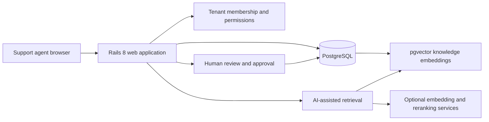

# Rails 8 AI Customer Support Desk

[](https://github.com/dangkhoa2016/Rails-8-AI-Customer-Support-Desk/actions/workflows/ci.yml)


[](LICENSE)
[](docs/MODEL_LICENSES.md)


> 🌐 Language / Ngôn ngữ: **English** | [Tiếng Việt](README.vi.md)

**Multi-tenant support operations · bilingual knowledge · evidence-led AI assistance · human approval**


A bilingual, multi-tenant customer support desk built with **Ruby on Rails 8, PostgreSQL, pgvector, Hotwire and optional AI retrieval services**. The project combines everyday support operations—tickets, customers, team management and a curated knowledge base—with evidence-oriented AI assistance and explicit human control.


> **Project scope:** A working development and evaluation application using **synthetic business data**. The included demo sign-in is not a production authentication mechanism. Production deployment, delivery integrations and real customer data are outside the demonstrated scope.

## Why this project?

A helpful support desk needs more than a chatbot. Agents must see the correct customer, know which business policy applies, understand the ticket's history, coordinate with colleagues and approve any action that affects a customer. AI can improve discovery, but it must never silently change subscriptions, orders, refunds or sent replies.

This implementation puts **tenant isolation, traceable knowledge, human approval and operational UX** first.

## What you can explore

| Area | Implemented capabilities |
| --- | --- |
| Ticket workspace | Create and browse tickets; filter by tenant; inspect conversations, priorities, statuses and assignments; add public and internal messages |
| Customer workspace | Browse customer profiles and linked support activity; manage records within the tenant's permissions |
| Team and permissions | Tenant membership roles (`owner`, `admin`, `agent`, `viewer`) with action-specific server-side authorization |
| Knowledge management | Bilingual articles, versioned content, approval workflow and evidence-linked retrieval candidates |
| AI-assisted search | Optional multilingual query embeddings, vector candidate retrieval and reranking against approved tenant knowledge |
| Business context | TeamFlow subscription/invoice/activation lookups and NovaMart order/payment/shipment/return context |
| Organization settings | Tenant-specific configuration and staff administration |
| Platform operations | Separate Platform Admin identity model, organization lifecycle tooling, MFA and dedicated security audit boundaries |
| Interface | Server-rendered Rails views, Hotwire interactions and English/Vietnamese localization |

The platform identity and tenant identity systems are deliberately separate: **a Platform Admin is not automatically a customer-support agent and cannot inherit access to tenant tickets or knowledge**.

## How the pieces fit together



For a deeper walkthrough of the data model, role boundaries and search path, see [Architecture](docs/ARCHITECTURE.md).

## Designed for two realistic support domains

The repository contains **fictional organizations**, not data or operating policies belonging to real companies.

| Organization | Business scenario | Examples |
| --- | --- | --- |
| **TeamFlow Cloud** | B2B SaaS subscriptions | Plans, invoices, payment reconciliation, activation events, billing questions and service incidents |
| **NovaMart Store** | E-commerce customer care | Products, orders, payments, partial shipments, returns and warranty requests |

The restored development dataset used for acceptance contained **2 organizations, 8 users, 240 tickets, 440 ticket messages and 84 stored embeddings**. These are snapshot counts, not fixed application limits. Each business has a synthetic policy catalogue and English/Vietnamese knowledge content. See [Demo data](docs/DEMO_DATA.md).

## AI assistance with guardrails

The optional retrieval pipeline uses:

1. A query scoped to the **current verified organization and permitted staff role**.
2. Multilingual embeddings, with **`Qwen/Qwen3-Embedding-4B`** as the pinned integration model.
3. Candidate lookup in PostgreSQL using **pgvector** (`vector(2560)` in the evaluated dataset).
4. Reranking with the pinned **`Qwen/Qwen3-Reranker-4B`** integration.
5. Knowledge provenance, relevance checks and an answerability gate for approved material.

AI retrieval is **assist-only**. It does not automatically send customer replies, approve articles, issue refunds, activate plans or modify order state. Such actions remain explicit, permission-checked human workflows. The repository includes tests and model integration clients; live GPU availability and inference credentials are **not** bundled.

## Technology

- **Backend:** Ruby 3.3, Rails 8, Active Record, PostgreSQL.
- **Retrieval:** pgvector, embedding and reranker clients, provenance and relevance validation.
- **Background work:** Solid Queue for optional asynchronous AI-search jobs.
- **Frontend:** ERB, Turbo/Stimulus and responsive bilingual views; no mandatory frontend build system.
- **Security:** Tenant-scoped access policy, password sessions, independent platform authentication with TOTP MFA, audit records and read-only public-preview boundaries.
- **Testing:** Rails/Minitest, integration/security tests and offline fixture validation.

## Run locally

**Requirements:** Ruby 3.3 (the repository's `.ruby-version` specifies 3.3.8), Bundler, PostgreSQL with the pgvector extension, and a local development database. Docker configuration is also included, but its deployment behavior depends on your local environment.

```bash
git clone https://github.com/dangkhoa2016/Rails-8-AI-Customer-Support-Desk.git
cd Rails-8-AI-Customer-Support-Desk

bundle install

# Configure a disposable PostgreSQL database and a dedicated local login.
# Set PGHOST, PGPORT, PGUSER, PGPASSWORD and PGDATABASE in your environment.
export RAILS_ENV=development
export M1_SYNTHETIC_DEMO=YES

bin/rails db:create db:migrate
bin/rails runner db/seeds/m1_full_business_records.rb

bin/rails server -b 127.0.0.1 -p 3000
```

Open **`http://127.0.0.1:3000/demo/sign_in`** and select a synthetic staff identity. The M1 seed provides an initial demo; expanded knowledge and ticket fixtures have separate import scripts and validation requirements. See [Local development](docs/LOCAL_DEVELOPMENT.md) before importing additional datasets.

**Never expose the passwordless demo login to a public host.** Public evaluation previews need a separate password gate and enforced read-only restrictions. The Platform Admin sandbox is not part of a public demo.

## Run tests

Use a dedicated, disposable test database. Ensure PostgreSQL and pgvector are available, then run:

```bash
RAILS_ENV=test bin/rails db:migrate
RAILS_ENV=test bin/rails test
```

The most recent complete regression in the restored evaluation environment reported **184 tests, 5,888 assertions, 0 failures, 0 errors and 0 skips** (November 16, 2026). These checks do not constitute a production penetration test or an independent model-quality benchmark.

## Repository structure

```text
app/          Rails controllers, models, authorization, jobs and views
config/       Routes, localization and application settings
db/           Migrations and synthetic data importers
data/         Reproducible synthetic knowledge and business fixtures
docs/         Public architecture, setup, security and demo-data guides
lib/          Shared application and preview-gate code
modal_app/    Optional model inference integration
script/       Validation and development utilities
test/         Unit, integration and security regression coverage
preview/      Static knowledge/editorial demonstration assets
```

Historical internal execution logs, infrastructure notes and dated checkpoints are intentionally **not distributed with the public repository**.

## Documentation

| Guide | Link |
| --- | --- |
| Documentation index | [INDEX.md](docs/INDEX.md) |
| Product scope | [PRODUCT_SCOPE.md](docs/PRODUCT_SCOPE.md) |
| System architecture | [ARCHITECTURE.md](docs/ARCHITECTURE.md) |
| Local development | [LOCAL_DEVELOPMENT.md](docs/LOCAL_DEVELOPMENT.md) |
| Synthetic business data | [DEMO_DATA.md](docs/DEMO_DATA.md) |
| Policy and fixture provenance | [DATA_GOVERNANCE.md](docs/DATA_GOVERNANCE.md) |
| HTTP routes and integrations | [API.md](docs/API.md) |
| Operations | [OPERATIONS.md](docs/OPERATIONS.md) |
| Testing and verification | [TESTING.md](docs/TESTING.md) |
| Security boundaries | [SECURITY.md](docs/SECURITY.md) |
| Model license compliance | [MODEL_LICENSES.md](docs/MODEL_LICENSES.md) |
| Deployment limits | [DEPLOYMENT.md](docs/DEPLOYMENT.md) |
| Troubleshooting | [TROUBLESHOOTING.md](docs/TROUBLESHOOTING.md) |
| Engineering roadmap | [ROADMAP.md](docs/ROADMAP.md) |

## Policy provenance and model rights

The original, immutable synthetic policy blueprint and the reviewed canonical blueprint now live in `data/policy/`; they are separate artifacts by design. The [data-governance guide](docs/DATA_GOVERNANCE.md) explains how they protect the policy baseline.

The optional `Qwen/Qwen3-Embedding-4B` and `Qwen/Qwen3-Reranker-4B` integrations reference upstream **Apache-2.0** models. **No model weights or API credentials are bundled.** See [model licenses](docs/MODEL_LICENSES.md), the local [Apache 2.0 text](THIRD_PARTY_LICENSES/Apache-2.0.txt) and the original project [MIT license](LICENSE).

## Continuous integration and community

A GitHub Actions workflow is supplied at [CI](.github/workflows/ci.yml), covering Rails/PostgreSQL/pgvector, deterministic policy validation and bilingual documentation. **The badge reflects actual GitHub executions after publication; a local PASS is not a CI PASS.** Contributions, issue templates, private security reporting and support details are under [`.github/`](.github/CONTRIBUTING.md).

## Scope and limitations

This repository demonstrates a **working support-desk implementation and an evaluated synthetic-data workflow**, not a ready-to-onboard SaaS service. No real customer data, production operator credentials, production-grade network perimeter, live email delivery or guaranteed GPU endpoints are included. AI quality evidence from limited sample runs should not be generalized to unseen production cases.

The practical next steps are secure production deployment design, independent access-control testing, broader knowledge review, external integration contracts and operational monitoring.

## License

MIT — see [LICENSE](LICENSE). Copyright © 2026 Đăng Khoa.

Maintainer: **Đăng Khoa <i.am@dangkhoa.dev>**.
