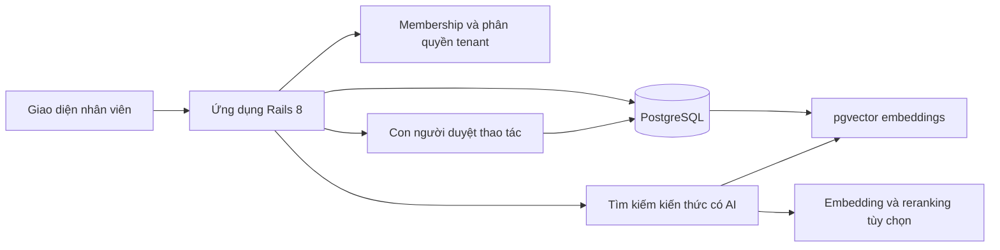

# Rails 8 AI Customer Support Desk

Hệ thống **chăm sóc khách hàng đa doanh nghiệp, song ngữ Việt–Anh**, xây dựng với **Ruby on Rails 8, PostgreSQL, pgvector, Hotwire và dịch vụ truy xuất AI tùy chọn**. Dự án kết hợp quản lý ticket, khách hàng, nhân viên, kho kiến thức và ngữ cảnh nghiệp vụ với AI hỗ trợ tìm kiếm, có kiểm soát quyền và xác nhận của con người.

**[English](README_EN.md)** · **Tiếng Việt** · [Kiến trúc](docs/ARCHITECTURE_VI.md) · [Cài đặt](docs/LOCAL_DEVELOPMENT_VI.md) · [Bảo mật](docs/SECURITY_VI.md)

> **Phạm vi:** Ứng dụng đang hoạt động cho phát triển và đánh giá trên **dữ liệu doanh nghiệp giả lập**. Đăng nhập nhanh bằng tài khoản demo không phải cơ chế xác thực production. Dự án không đóng gói dữ liệu khách hàng thực hay hạ tầng triển khai sản xuất.

## Vì sao phát triển dự án này?

Một bộ phận hỗ trợ khách hàng hiệu quả cần nhiều hơn một chatbot. Nhân viên phải nhìn đúng khách hàng và doanh nghiệp, hiểu lịch sử trao đổi, áp dụng đúng chính sách, phối hợp với đồng nghiệp và chủ động xác nhận các thao tác ảnh hưởng đến người dùng. AI có thể giúp tìm kiến thức nhanh hơn, nhưng không được tự ý thay đổi gói dịch vụ, đơn hàng, hoàn tiền hoặc gửi câu trả lời.

Dự án ưu tiên **cách ly tenant, khả năng truy xuất nguồn gốc, human-in-the-loop và trải nghiệm vận hành**.

## Các chức năng chính

| Nhóm | Khả năng đã triển khai |
| --- | --- |
| Quản lý ticket | Tạo, tra cứu và lọc ticket; theo dõi hội thoại, mức ưu tiên, trạng thái, người xử lý; ghi chú nội bộ và tin nhắn công khai |
| Quản lý khách hàng | Hồ sơ khách hàng và hoạt động hỗ trợ; quản lý trong phạm vi quyền của doanh nghiệp |
| Nhân sự và phân quyền | Các vai trò `owner`, `admin`, `agent`, `viewer`; kiểm tra quyền tại server cho từng hành động |
| Kho kiến thức | Bài viết Việt–Anh, quản lý phiên bản, quy trình phê duyệt và liên kết nguồn tham khảo |
| Tìm kiếm AI | Embedding đa ngôn ngữ, tìm ứng viên bằng vector, reranking trên kiến thức đã duyệt của đúng tenant |
| Ngữ cảnh nghiệp vụ | TeamFlow: gói thuê bao, hóa đơn, kích hoạt; NovaMart: đơn hàng, thanh toán, giao từng phần, đổi trả và bảo hành |
| Thiết lập doanh nghiệp | Cài đặt riêng cho tenant và quản lý nhân viên |
| Quản trị nền tảng | Danh tính Platform Admin độc lập, quản lý vòng đời tổ chức, MFA và ranh giới audit riêng |
| Giao diện | Rails server-rendered, Hotwire, responsive, hỗ trợ tiếng Việt và tiếng Anh |

**Platform Admin không phải một vai trò tenant.** Quyền quản trị nền tảng không mặc nhiên cho phép đọc ticket, khách hàng hoặc kho kiến thức của doanh nghiệp.

## Kiến trúc tổng quan



Xem [tài liệu kiến trúc](docs/ARCHITECTURE_VI.md) để tìm hiểu mô hình dữ liệu, ranh giới phân quyền và đường đi của truy vấn.

## Hai doanh nghiệp giả lập

Đây là **hai tổ chức hoàn toàn giả lập**, không đại diện cho chính sách của doanh nghiệp có thật.

| Doanh nghiệp | Bối cảnh | Ví dụ hỗ trợ |
| --- | --- | --- |
| **TeamFlow Cloud** | SaaS cho doanh nghiệp | Gói dịch vụ, hóa đơn, đối soát thanh toán, kích hoạt, thay đổi gói và sự cố |
| **NovaMart Store** | Thương mại điện tử | Sản phẩm, đơn hàng, thanh toán, giao hàng từng phần, đổi trả, bảo hành |

Snapshot development đã dùng để nghiệm thu có **2 doanh nghiệp, 8 người dùng, 240 ticket, 440 tin nhắn và 84 embeddings**. Đây là thống kê của bộ dữ liệu mẫu, không phải giới hạn của ứng dụng. Mỗi doanh nghiệp có chính sách và kiến thức tiếng Việt/tiếng Anh để thực hành xử lý tình huống. Xem [dữ liệu demo](docs/DEMO_DATA_VI.md).

## AI hỗ trợ, con người quyết định

Pipeline truy xuất kiến thức tùy chọn gồm:

1. Nhận câu hỏi trong ngữ cảnh **tenant và vai trò nhân viên đã xác thực**.
2. Sinh vector đa ngôn ngữ bằng tích hợp **`Qwen/Qwen3-Embedding-4B`**.
3. Tìm các đoạn kiến thức liên quan trong PostgreSQL/pgvector (dữ liệu đánh giá sử dụng `vector(2560)`).
4. Sắp xếp lại các ứng viên với **`Qwen/Qwen3-Reranker-4B`**.
5. Kiểm tra nguồn gốc, độ liên quan và điều kiện cho phép sử dụng kiến thức đã phê duyệt.

AI **chỉ hỗ trợ**. Hệ thống không tự gửi email/tin nhắn cho khách hàng, không tự duyệt bài viết, hoàn tiền, kích hoạt gói hoặc thay đổi trạng thái đơn hàng theo đề xuất AI. Các hành động nghiệp vụ vẫn cần nhân viên có quyền thực hiện hoặc phê duyệt. Repo có client tích hợp và test, nhưng **không cung cấp sẵn credential hay GPU inference endpoint đang hoạt động**.

## Công nghệ sử dụng

- **Backend:** Ruby 3.3, Rails 8, Active Record và PostgreSQL.
- **AI retrieval:** pgvector, embedding/reranker client, kiểm tra provenance và relevance.
- **Background jobs:** Solid Queue cho luồng AI search bất đồng bộ tùy chọn.
- **Frontend:** ERB, Turbo/Stimulus, giao diện responsive và bản địa hóa VI/EN.
- **Bảo mật:** phân quyền theo membership, password session, Platform Admin độc lập với TOTP MFA, audit, preview chỉ đọc.
- **Kiểm thử:** Rails/Minitest, integration/security tests và bộ kiểm tra fixture offline.

## Cài đặt trên máy phát triển

**Yêu cầu:** Ruby 3.3 (file `.ruby-version` khai báo 3.3.8), Bundler, PostgreSQL đã hỗ trợ pgvector và database riêng để thử nghiệm. Có cấu hình Docker nhưng cần kiểm tra theo máy triển khai.

```bash
git clone https://github.com/dangkhoa2016/Rails-8-AI-Customer-Support-Desk.git
cd Rails-8-AI-Customer-Support-Desk

bundle install

# Thiết lập PostgreSQL dành riêng cho local development:
# PGHOST, PGPORT, PGUSER, PGPASSWORD, PGDATABASE.
export RAILS_ENV=development
export M1_SYNTHETIC_DEMO=YES

bin/rails db:create db:migrate
bin/rails runner db/seeds/m1_full_business_records.rb

bin/rails server -b 127.0.0.1 -p 3000
```

Mở **`http://127.0.0.1:3000/demo/sign_in`** và chọn nhân viên giả lập. Bộ seed M1 cung cấp dữ liệu khởi đầu; dữ liệu ticket và knowledge mở rộng có quy trình import/validation riêng. Đọc [hướng dẫn local](docs/LOCAL_DEVELOPMENT_VI.md) trước khi nhập thêm dữ liệu.

**Không đưa màn hình đăng nhập demo không cần mật khẩu lên Internet.** Việc xem demo qua public preview phải có lớp mật khẩu riêng và chặn ghi. Sandbox Platform Admin không phải một phần của demo công khai.

## Chạy kiểm thử

Sử dụng database test riêng biệt, có PostgreSQL và pgvector:

```bash
RAILS_ENV=test bin/rails db:migrate
RAILS_ENV=test bin/rails test
```

Lần kiểm thử Rails đầy đủ gần nhất trên môi trường đánh giá đã khôi phục ghi nhận **184 tests, 5.888 assertions, 0 failures, 0 errors và 0 skips** (16/11/2026). Đây không phải chứng nhận bảo mật production hoặc đánh giá độc lập toàn diện về chất lượng mô hình.

## Cấu trúc repository

```text
app/          Controller, model, policy, job và view Rails
config/       Routes, bản địa hóa và thiết lập ứng dụng
db/           Migration và importer dữ liệu demo
data/         Dữ liệu nghiệp vụ và kiến thức giả lập
docs/         Tài liệu công khai về kiến trúc, cài đặt, bảo mật và dữ liệu
lib/          Thư viện dùng chung và preview gate
modal_app/    Tích hợp inference tùy chọn
script/       Công cụ kiểm tra và phát triển
test/         Unit/integration/security regression
preview/      Giao diện tĩnh phục vụ tham khảo kiến thức
```

Log nội bộ, handoff, hướng dẫn vận hành riêng và checkpoint lịch sử **không được phân phối trong repository công khai**.

## Tài liệu

- [Kiến trúc và cách ly dữ liệu](docs/ARCHITECTURE_VI.md)
- [Cài đặt và kiểm thử local](docs/LOCAL_DEVELOPMENT_VI.md)
- [Nguyên tắc bảo mật](docs/SECURITY_VI.md)
- [Doanh nghiệp và dữ liệu giả lập](docs/DEMO_DATA_VI.md)
- [README tiếng Anh](README_EN.md)

## Phạm vi và hướng phát triển

Repository minh họa **một hệ thống support desk đã có triển khai và kiểm thử trên dữ liệu giả lập**, không phải dịch vụ SaaS sẵn sàng bán cho khách hàng thực. Không có dữ liệu cá nhân thực, credential Platform Admin production, hạ tầng public production hoàn chỉnh, email outbound hoặc cam kết GPU endpoint hoạt động liên tục. Kết quả đánh giá AI trên tập nhỏ không chứng minh độ chính xác cho mọi câu hỏi ngoài thực tế.

Các hướng tiếp theo gồm hoàn thiện hạ tầng production an toàn, kiểm thử phân quyền độc lập, mở rộng kiểm duyệt kho kiến thức, hợp đồng tích hợp và quan sát vận hành.

## Giấy phép

MIT — xem [LICENSE](LICENSE). Copyright © 2026 Đăng Khoa.
